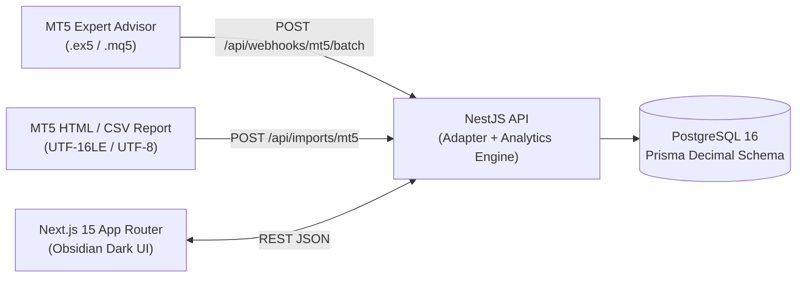

# TrackDailyTrade — Multi-Platform Trading Journal & Analytics

**TrackDailyTrade** là nền tảng Nhật ký Giao dịch (Trading Journal) chuyên sâu lấy cảm hứng từ **TradeZella Pro**, được xây dựng theo kiến trúc **Adapter đa nền tảng** với độ chính xác số học tài chính tuyệt đối (`Decimal`), giao diện **Obsidian Dark Fintech** hiện đại và đồng bộ thời gian thực cùng **MetaTrader 5**.

---

## Tính năng nổi bật

### 1. Đồng bộ đa nền tảng (Auto-Sync Adapter Architecture)
- **MT5 Realtime Webhook EA (`TrackDailyTrade.ex5` / `.mq5`)**:
  - Tự động gửi lệnh đóng theo thời gian thực + cơ chế **Backfill chống sót lệnh** khi khởi động hoặc bấm nút **`Sync Now (7d)`** ngay trên biểu đồ MT5.
  - **Gom lệnh Partial Close chuẩn xác**: Tổng hợp toàn bộ các lần đóng từng phần theo `positionId` (khối lượng, giá mở/đóng trung bình gia quyền, Gross PnL, Commission, Fee, Swap).
  - **Khóa tự động `Initial Stop Loss` & `1R`**: Tự bắt SL ngay lúc mở lệnh hoặc lần đầu kéo SL trên biểu đồ và khóa cứng (không bị mất khi dời SL hòa vốn / trailing).
  - **Đồng bộ trực tiếp `Balance` & `Equity` thực tế** từ MT5 và lọc sạch 100% giao dịch nạp/rút tiền (`DEAL_TYPE_BALANCE`, `CREDIT`, `BONUS`).
- **MT5 Statement Importer (`.html` / `.htm` / `.csv`)**:
  - Tự động nhận diện cả mã hóa **UTF-16LE** mặc định của MT5 lẫn **UTF-8**, đọc chuẩn bảng `Positions`, quy đổi múi giờ sàn (`Europe/Athens` DST GMT+2/GMT+3) về UTC và hỗ trợ xem trước (**Dry Run Preview**) chống trùng lặp an toàn.

### 2. Phân tích hiệu suất chuyên sâu (Pro Analytics)
- **KPIs cốt lõi**: Net PnL, Win Rate, Profit Factor, Expectancy (`$` & `R-Multiple`), Avg Win / Avg Loss, Max Drawdown (`$` & `%`), Thời gian giữ lệnh trung bình.
- **Equity Curve & Drawdown Underwater**: Kết hợp biểu đồ **TradingView Lightweight Charts** và biểu đồ lợi nhuận tích lũy kèm vùng sụt giảm tài khoản phía dưới trục `$0`.
- **Zella Score · Consistency Radar**: Chấm điểm tổng hợp `0–100` trên biểu đồ Radar 5 trục (*Win Rate*, *Profit Factor*, *Avg W/L*, *Kỷ luật SL*, *Độ ổn định*).
- **Performance by Session**: Tự động phân loại hiệu suất theo **Phiên Á (`Tokyo`)**, **Phiên Âu (`London`)** và **Phiên Mỹ (`New York`)** dựa trên giờ mở lệnh UTC.
- **Calendar PnL & Breakdowns**: Lịch nhiệt lợi nhuận theo ngày/tuần, biểu đồ phân tích theo khung giờ trong ngày, thứ trong tuần, thời gian giữ lệnh và **Strategy Tags** (`BB Tier 3`, `SMC MTF`, `Tier SSS`...).

### 3. Nhật ký giao dịch & Chia sẻ kết quả
- **Trade Detail Sheet**: Đính kèm ảnh chụp biểu đồ **TradingView Snapshot** (dán link hoặc nhấn `Ctrl+V` / `Cmd+V` dán ảnh trực tiếp), ghi chú **Pre-trade Plan** & **Post-trade Review**, gắn Tag chiến lược và tinh chỉnh thủ công `Initial SL` / `1R` với kết quả `R-Multiple` xem trước tức thì.
- **Share Trade Card (PNG)**: Xuất thẻ kết quả giao dịch độ phân giải cao (`1200×675`) kèm chế độ **Privacy Mode** tự động ẩn số tiền `$` & khối lượng lot để chỉ chia sẻ `R-Multiple` / `% lợi nhuận`.

---

## Kiến trúc hệ thống & Tech Stack



| Tầng | Công nghệ sử dụng |
|---|---|
| **Monorepo** | `pnpm` workspaces + **Turborepo** + TypeScript 5 |
| **Frontend (`apps/web`)** | **Next.js 15** (App Router), React 19, TailwindCSS, Radix UI, **TradingView Lightweight Charts**, **Recharts**, `Inter` & `JetBrains Mono` (`tabular-nums`) |
| **Backend (`apps/api`)** | **NestJS 11**, **Prisma ORM**, `decimal.js` (0 sai số dấu phẩy động), `luxon` (DST Timezone), `cheerio`, `csv-parse`, `zod` |
| **Shared (`packages/shared`)** | Shared Zod validation schemas, DTOs & TypeScript interfaces |
| **Database** | **PostgreSQL 16** (Docker Compose) |
| **MT5 Integration (`ea/`)** | Pure **MQL5** Expert Advisor (`TrackDailyTrade.mq5` + bản biên dịch sẵn `.ex5`) |

---

## Cấu trúc thư mục

```text
Track-Trading-Journal/
├── apps/
│   ├── api/                    # Backend NestJS + Prisma + Jest unit tests
│   └── web/                    # Frontend Next.js 15 (Obsidian Dark UI)
│       └── public/downloads/   # Tệp TrackDailyTrade.ex5 tải nhanh cho người dùng
├── packages/
│   └── shared/                 # Zod schemas & TypeScript types dùng chung FE/BE
├── ea/
│   ├── TrackDailyTrade.mq5     # Mã nguồn MQL5 Expert Advisor
│   └── README.md               # Tài liệu chi tiết cài đặt EA trên MT5
├── docker-compose.yml          # PostgreSQL 16 local container
└── turbo.json                  # Cấu hình pipeline Turborepo
```

---

## Hướng dẫn khởi chạy nhanh (Local Development)

### Yêu cầu môi trường
- **Node.js** `>= 20` và **pnpm** (`npm install -g pnpm`)
- **Docker** (Docker Desktop / OrbStack) để chạy PostgreSQL 16

### Các bước cài đặt

```bash
# 1. Cài đặt toàn bộ dependencies trong monorepo
pnpm install

# 2. Tạo file biến môi trường từ mẫu có sẵn
cp .env.example .env
cp apps/api/.env.example apps/api/.env

# 3. Khởi chạy PostgreSQL 16 bằng Docker Compose
pnpm db:up

# 4. Chạy Prisma migration và nạp dữ liệu mẫu ban đầu
pnpm db:migrate
pnpm db:seed

# 5. Chạy đồng thời Backend API (port 3001) & Frontend Web (port 3000)
pnpm dev
```

Truy cập ứng dụng tại:
- **Web Dashboard**: `http://localhost:3000`
- **API Healthcheck**: `http://localhost:3001/api/health`
- **Prisma Studio**: `pnpm db:studio`

---

## Kết nối MetaTrader 5 trong 1 phút

1. Mở ứng dụng tại `http://localhost:3000/import` và nhấn nút **`Tải TrackDailyTrade.ex5`**.
2. Trong **MetaTrader 5**, mở `Tools → Options → Expert Advisors` (`Công cụ → Tùy chọn → Công cụ đặc biệt`):
   - Bật **Allow Algorithmic Trading** (`Cho phép algorithmic trading`).
   - Bật **Allow WebRequest for listed URL** và thêm: `http://127.0.0.1:3001`
3. Vào `File → Open Data Folder` (`Tập tin → Mở thư mục dữ liệu`), chép `TrackDailyTrade.ex5` vào `MQL5/Experts/`, làm mới thanh **Navigator** rồi kéo thả EA vào **1 biểu đồ bất kỳ**.

---

## Lệnh kiểm thử & Build Production

```bash
# Chạy bộ Unit Tests (Jest)
pnpm test

# Kiểm tra kiểu tĩnh TypeScript trên toàn bộ workspaces
pnpm typecheck

# Build bản Production cho shared, api và web
pnpm build
```
